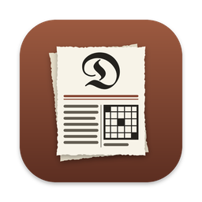
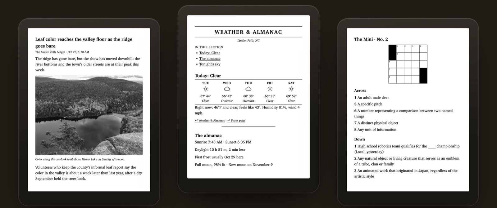

# Deckle for Unraid

The Unraid Community Applications template for **Deckle**, a morning newspaper for your e-reader.
Every morning it sets a real paper from your town's news and weather, your RSS feeds and the
articles you saved, and has it waiting on your Kindle or KOReader before you're up.

[Deckle](https://github.com/CasaVargas/deckle) &middot;
[Container guide](https://github.com/CasaVargas/deckle/blob/main/docs/docker.md) &middot;
[Support](https://github.com/CasaVargas/deckle/issues)

## Install

**Apps** tab, search **Deckle**, then:

1. Pick your **TZ**. Papers print on that zone's clock.
2. Set a **Web UI password** (12 or more characters). Without one the web UI stays off and only
   the schedule runs.
3. To email the paper to a Kindle, fill in **Kindle email password**.
4. **Apply**, then open the WebUI on port 8080.

The first start writes a starter `digest.toml` in `/config/deckle`. Set your town, feeds, the
morning time and delivery in the web UI's Daily tab.

## The two paths

| Mount | Holds | Default |
|---|---|---|
| `/config` | `digest.toml`, papers, state | `/mnt/user/appdata/deckle` |
| `/data` | `Deckle/`: the Morgue, Inbox, uploads, exports | `/mnt/user/deckle` |

## Optional ports

Under **Show more settings**. KOReader over Wi-Fi and the calibre connection stay off until you
turn them on in the Daily tab's Delivery.

| Port | For |
|---|---|
| 47219 | The bookmarklet: save a page to tomorrow's paper. Set **Bookmarklet address** too. |
| 47220 | KOReader over Wi-Fi: the paper and your books in KOReader's catalog. Set **KOReader over Wi-Fi address** too. |
| 9090 | KOReader's calibre connection. Readers find it by themselves only with Network Type: host. |

## Worth knowing

- **No Kindle book conversion.** Enhanced Typesetting, X-Ray and Word Wise need Kindle Previewer,
  which only runs on Mac and Windows. The paper builds without it.
- **Kindle by email only.** There's no USB in the container. Add the `from` address to Amazon's
  Approved Personal Document E-mail List.
- **Plain HTTP.** Beyond your home network, put the web UI behind a reverse proxy with TLS (SWAG,
  Nginx Proxy Manager). Never expose the bookmarklet or reader ports to the internet.

The full guide, including moving from the desktop app and running the AI editor beside Ollama, is
[docs/docker.md](https://github.com/CasaVargas/deckle/blob/main/docs/docker.md).

## Keeping up

The template is edited in the Deckle repository at
[`docker/unraid/deckle.xml`](https://github.com/CasaVargas/deckle/blob/main/docker/unraid/deckle.xml)
and copied here. File issues at [CasaVargas/deckle](https://github.com/CasaVargas/deckle/issues).

> The MIT license in this repository covers these templates and docs. Deckle itself is
> GPL-3.0-or-later.
